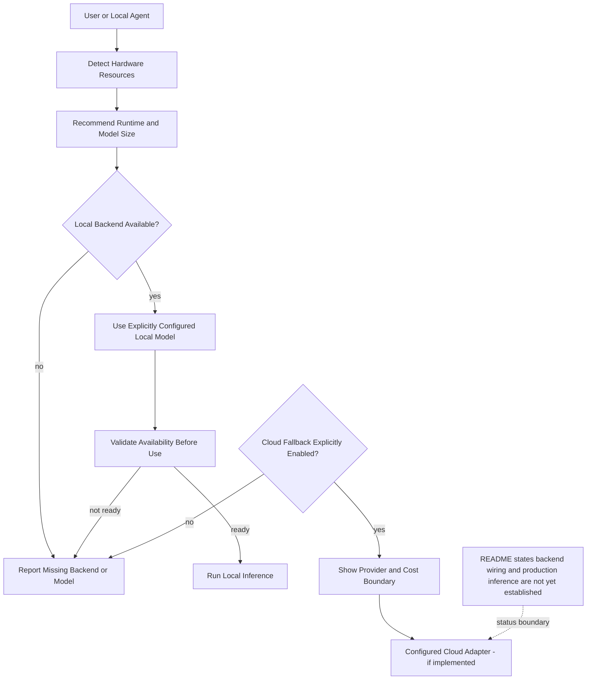

# x4-local-ai-runtime

[](https://github.com/dhe-cruzer69/x4-local-ai-runtime/actions)
[](LICENSE)

**Local-first model runtime with hardware-aware recommendations.**

Detect hardware, recommend runtime/model size, optional cloud fallback (explicit, never silent).

## Quick start

```bash
pip install -e ".[dev]"
x4-ai detect
x4-ai recommend --ram 8 --gpu-vram 0
```

## Design

- Local-first by default
- Cloud fallback only when explicitly enabled
- No production inference claims until backends are wired and tested

<!-- X4-APEX-DIAGRAM-START:x4-local-ai-runtime -->



<!-- X4-APEX-DIAGRAM-END:x4-local-ai-runtime -->

## License

Apache-2.0

## APEX Architecture Map

> Status: architecture documentation; implementation and deployment claims require independent verification.

**Evidence note:** Model pulling, cache persistence, offline fallback, and readiness semantics must be verified against runtime code and tests.

